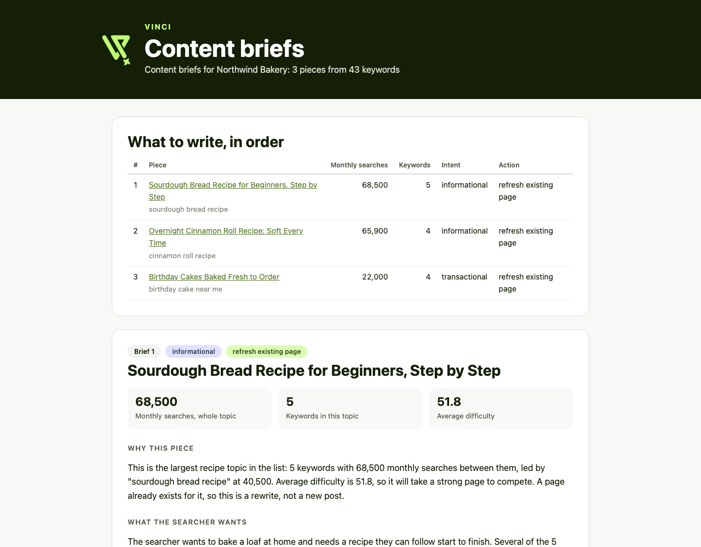
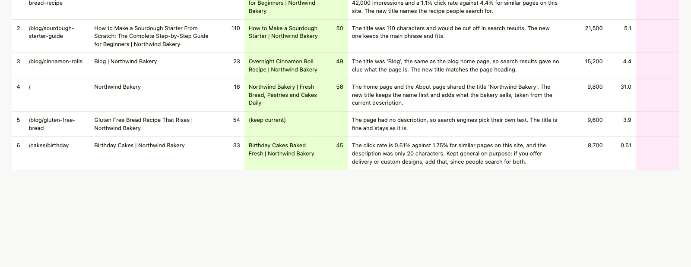

# Vinci

**A Claude skill that turns keyword lists and site crawls into content briefs and title rewrites a team can act on.**

Vinci is a free, open skill for SEO strategists and content leads. Drop in the exports you already
download and get back:

- **Content briefs** for writers: one per topic, with target keywords, the questions to answer,
  an outline, pages to link to, and a title and description that fit.
- **A title and description review sheet** for whoever signs off on-page changes: old next to
  new, lengths checked, the reason for each change, in priority order.

It is built on one rule: **scripts calculate, Claude writes.** Grouping keywords, adding up demand,
measuring lengths, finding duplicates and setting priorities are done in Python. Claude writes the
briefs and the titles. Nothing is rendered until the writing agrees with the data.





## Start here (no coding needed)

1. Download `vinci.zip` from the [latest release](../../releases/latest). Don't unzip it.
2. In Claude, turn on code execution: Settings > Capabilities > Code execution and file creation.
3. Upload the zip under Skills (Create skill > Upload a skill) and switch it on.
4. Start a chat, attach your keyword export and your crawl export, and ask:
   *"Turn these into content briefs and fix our titles."*

How to get the files out of Semrush, Ahrefs, Keyword Planner, Screaming Frog and Search Console:
[export guide](skills/vinci/references/exporting-data.md).

## What goes in, what comes out

| You upload | You get |
|---|---|
| A keyword list (Semrush, Ahrefs, Keyword Planner, Search Console queries, or your own CSV) | Keywords grouped into topics, ranked by demand, and a brief per topic: `briefs.html` plus one Markdown file per writer |
| A site crawl (Screaming Frog, Sitebulb, or any URL and title sheet) | An audit of every title and meta description, and `title_review.xlsx` with proposed rewrites |
| Both | Each topic matched to the page that should carry it, so briefs say "refresh this page" or "new page", and titles are checked against the topic's main keyword |
| A Search Console pages export (optional) | Pages ordered by impressions, and click rate compared with your own pages at similar positions |

Files are read exactly as downloaded: title lines, total rows, UTF-16 and zips are handled. No
API keys.

## What the checks stop

Vinci refuses to produce a deliverable when:

- a brief targets a keyword that isn't in its topic
- a number in a brief's summary can't be traced to the keyword data
- a brief links to a URL that isn't in the crawl
- a title is over 60 characters or a description is over 155
- two pages would end up with the same title or description
- a rewritten title drops the page's target keyword without a stated reason

## Try it with the sample data

`sample-data/northwind-bakery/` holds invented exports for a fictional bakery, with problems
planted in them. The finished outputs are in [`examples/northwind-bakery/`](examples/northwind-bakery/):
the [brief pack](examples/northwind-bakery/briefs.html), the
[writer briefs](examples/northwind-bakery/briefs/) and the
[review sheet](examples/northwind-bakery/title_review.csv).

## In Claude Code

```bash
cp -r skills/vinci ~/.claude/skills/vinci
```

## From the command line, without Claude

The analysis has no dependencies beyond Python 3.9. `openpyxl` is only needed to read `.xlsx`
inputs and to write the Excel review sheet.

```bash
python skills/vinci/scripts/vinci.py analyze sample-data/northwind-bakery --out out --client "Northwind Bakery" --brand-terms northwind
```

You get `clusters.json`, `keyword_clusters.csv` and `title_audit.json`. The briefs and rewrites
are the part Claude adds. To render the bundled example:

```bash
python skills/vinci/scripts/vinci.py render-briefs --out examples/northwind-bakery
```

```bash
python skills/vinci/scripts/vinci.py render-rewrites --out examples/northwind-bakery
```

## How it works

```
keyword list ─► group into topics ─► clusters.json ─► Claude writes briefs ──► check ─► briefs.html, briefs/*.md
                      │ match topics to pages
site crawl ───► audit titles ──────► title_audit.json ─► Claude writes rewrites ─► check ─► title_review.xlsx
Search Console ─► priority and click rate
```

Design choices:

- **Topics are grouped by shared words.** The highest-demand keyword leads each topic. Synonyms
  aren't merged automatically; `--merge` joins topics a human knows belong together.
- **Search volume and impressions are never mixed.** Each plan uses one, and names it.
- **Click rate is judged against the site itself.** A page is flagged when its click rate is under
  half of what this site's own pages get at similar positions, not against an outside benchmark.
- **Claude only describes what the data shows.** No word counts, competitor claims or invented
  offers: the skill has no search results or page content, and says so.

## Limits

- Tested on synthetic exports only. Column layouts follow commonly seen exports; if a file isn't
  recognized, Vinci says which one and lists the columns it saw. Anonymized real examples are very
  welcome.
- Word-overlap grouping is simpler than grouping by search results. Review the topics before
  writing.
- Length limits are in characters and are rules of thumb. They are listed in `title_audit.json`.
- Numbers must use US formatting (1,234.56).
- The checks confirm the work is valid, not that it is good. Read it once before sending.

## Development

```bash
python -m unittest discover tests
```

`python tools/make_sample_data.py` rewrites the sample exports. `python tools/package_skill.py`
builds `dist/vinci.zip`.

## License

MIT. See [LICENSE](LICENSE).

Built by Brie and Claude.
